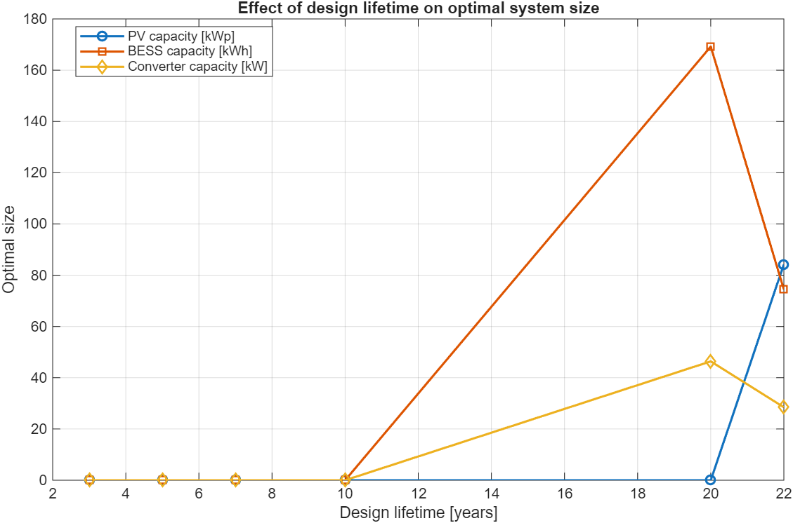
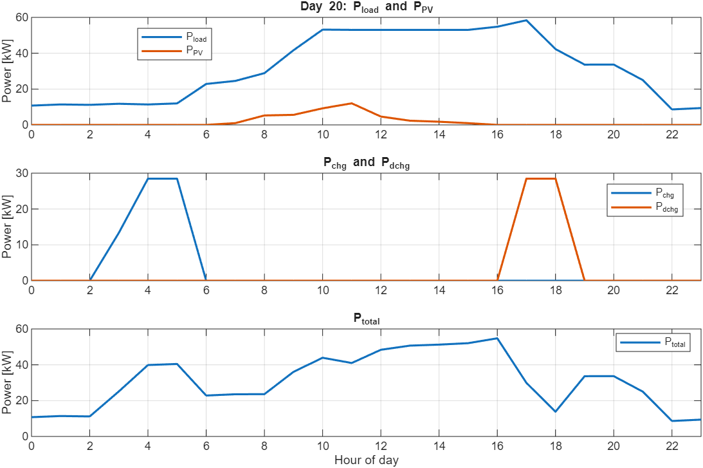
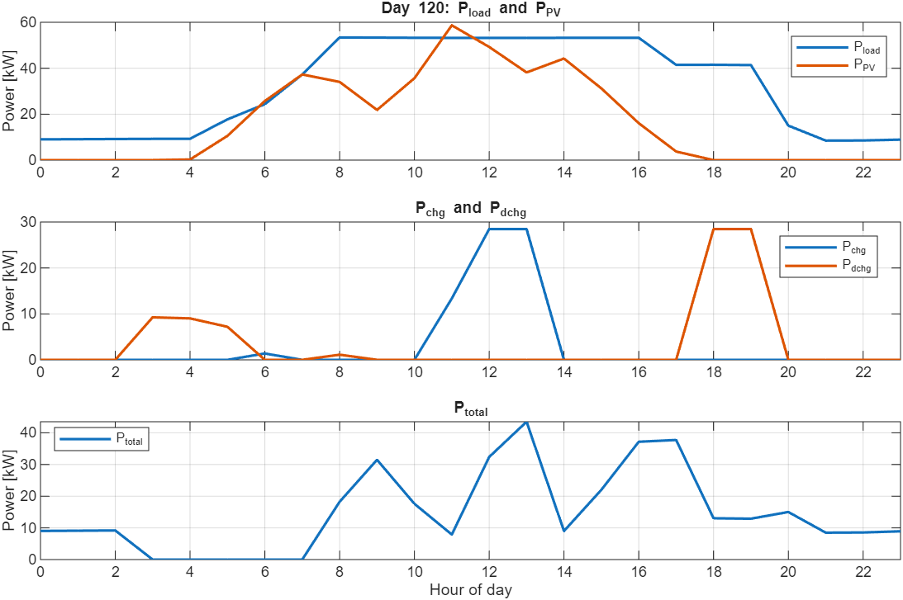
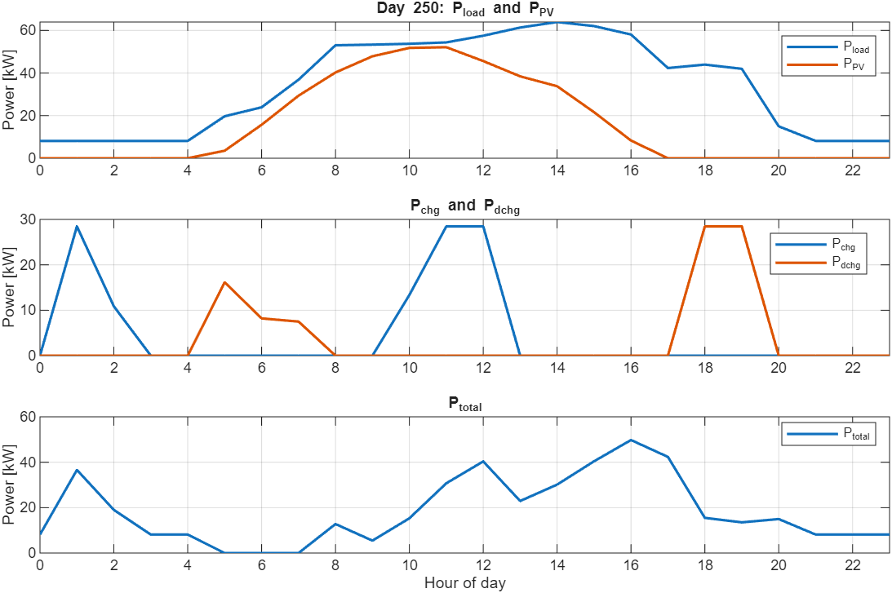

# PV and Battery Storage Sizing Optimization

**A MATLAB linear programming study of how the planning horizon affects PV, battery storage and converter sizing, with hourly operation scheduling.**

## Project background

This project was developed from an academic exercise in **Optimal Sizing and Operation of a Photovoltaic System with Storage**. The task materials, unique system parameters and hourly input datasets were supplied by my professor at the **Faculty of Electrical Engineering and Computing (FER), University of Zagreb**.

This repository focuses on the exercise's planning-horizon sensitivity study (Task 5), with an additional 22-year scenario. It brings together the MATLAB implementation, supplied input data for local use, reported results and operating plots.

## Engineering problem

A grid-connected electricity consumer can invest in photovoltaic generation and battery storage to change when electricity is purchased, used and exported. Those investments introduce equipment, maintenance and replacement costs, so installing more capacity does not necessarily reduce total cost.

The question examined here is:

> How does the selected planning horizon change the optimal PV capacity, battery energy capacity and battery converter rating?

The study considers **3, 5, 7, 10, 20 and 22 years**, keeping the input profiles and scenario parameters fixed across runs. Component replacement charges are triggered according to their assumed lifetimes.

## System and optimization method

The modeled system consists of an electrical load, PV generation, battery storage with a bidirectional converter, and a grid connection that can be enlarged.

The MATLAB model uses **linear programming (`linprog`)** to optimize equipment sizes and hourly operation together. Decision variables include:

- PV capacity in kWp, battery capacity in kWh and converter rating in kW.
- Additional grid connection capacity in kW.
- Hourly PV utilization, charging, discharging, grid import/export and stored battery energy.

The objective minimizes the implemented lifetime cost: electricity purchases minus export revenue, initial investment, maintenance, simplified replacement and battery degradation charges, and a peak-import cost term.

Constraints represent hourly power balance, storage energy dynamics and operating bounds, PV availability, shared converter capacity, battery C-rate sizing, grid connection limits, and annual imported energy at least equal to exported energy. Grid charging is permitted.

## Data source and inputs

**The three CSV datasets were supplied by my professor at FER, University of Zagreb, for the course exercise.** They are described here as *course-supplied data*. Their original measurement or simulation provenance has not been independently established, so this project does not label them as measured utility data or as synthetic data.

| Input | File | Role in the model |
|---|---|---|
| Electricity demand | `STU_015_load_1h.csv` | Hourly load profile |
| PV production profile | `STU_015_pv_1h.csv` | Available output scaled by installed PV capacity |
| Electricity market prices | `STU_015_price_1h.csv` | Hourly energy purchase/export valuation |

The bundled copies each contain **8,760 numeric samples**, with one column and no timestamps. Samples are assumed aligned at one-hour intervals. Hourly load energy in kWh is numerically equal to average power in kW for this time step. The PV profile is treated as output per installed kWp; its source normalization should be confirmed against course metadata.

Negative market prices are replaced with zero **on the professor's instruction**. The model retains a grid usage fee and a feed-in percentage. Battery and converter cost/lifetime parameters were modified for the demonstrated scenario, as permitted by the exercise to investigate a nonzero battery solution. See [parameter comparison](docs/PARAMETERS.md).

Course data are included in the local download but ignored by Git by default. Confirm permission before publicly redistributing them. Course slides and assignment PDFs are not included.

## Results

| Design lifetime (years) | PV (kWp) | Battery (kWh) | Converter (kW) |
|---|---:|---:|---:|
| 3 | 0 | 0 | 0 |
| 5 | 0 | 0 | 0 |
| 7 | 0 | 0 | 0 |
| 10 | 0 | 0 | 0 |
| 20 | 0 | 169.23 | 46.382 |
| 22 | 84.2354 | 74.4301 | 28.4695 |



The original chart combines three distinct units on one axis; the table above lists each capacity with its proper unit.

For the tested 3-10-year horizons, the model selects no new equipment. At 20 years, it selects grid-charged battery storage without PV. At 22 years, PV enters the selected design and battery/converter sizes are smaller than in the 20-year case.

These findings are conditional on the implemented model and modified parameters. The 21-year case was not tested, so the exact PV adoption threshold is not established. Changes reflect both the longer operating horizon and component replacement charges.

[Full results table, objective values and interpretation](results/README.md).

### Hourly operation: 22-year scenario

The following author-supplied figures show three days from the final scenario. `P_total` denotes net grid exchange. The charging schedule can use grid electricity as well as PV; prices and stored-energy profiles are needed to explain individual operating decisions.







## Run the study

Requires **MATLAB and Optimization Toolbox**. The author demonstrated the model using a HiGHS dual-simplex solver.

1. Download and extract this project.
2. Ensure the three input CSV files are in `data/local/`.
3. Open the project folder in MATLAB and run:

```matlab
run_project
```

The packaged script exports sizing tables, hourly dispatch for each horizon, numerical feasibility checks, figures and a MATLAB results file to `results/generated/`. Daily plots refer to the last horizon in the list, currently 22 years.

A public Git checkout does not include the ignored local datasets. See [input instructions](data/README.md).

## Assumptions and limitations

This is an academic model for studying sizing decisions, not a validated investment recommendation or a full reproduction of the lecture's financial formulation.

- Load, PV availability and prices repeat identically each year; discounting, escalation, outages and uncertainty are omitted.
- Peak import is represented by one annual variable charged once, rather than recurring monthly demand charges.
- One replacement is charged when a horizon exceeds a component lifetime; remaining resale value is omitted. The current cases extend only to 22 years.
- The discharge-only degradation charge is a simplification and is added to scheduled replacement costs.
- Budget and payback parameters are declared but not enforced as constraints. No budget-compliance or 12-year payback claim is made.
- The shared converter limit does not strictly prohibit simultaneous charging and discharging.
- The objective is modeled cost, not profit or NPV. Raw objective totals over different horizons are not a profitability ranking.


## Academic attribution and tools

The project builds on the 2025/2026 course exercise and LP teaching material **Optimal Sizing and Operation of a Photovoltaic System with Storage**, supplied through FER, University of Zagreb. The lecture authors are Mario Vasak, Vinko Lesic and Ninoslav Holjevac.

The core MATLAB script and demonstrated results were supplied by the project author. AI assistance supported code review, repository packaging, documentation and validation/export additions. This repository demonstrates **MATLAB**; a Python implementation is not included.

No license is assigned automatically. Reuse of course materials, datasets and coursework-derived code is subject to the relevant permissions.
